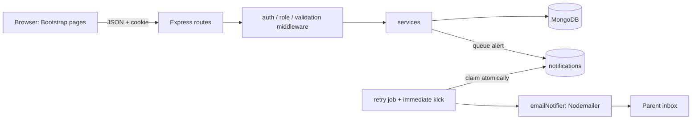

# Rollcall: Student Attendance and Parent Notification System

Faculty sign in, pick a class, and mark each student **Present** or **Absent**. Records are stored in MongoDB, and when a student is marked absent the parent is **emailed automatically** (once, and only after the record is saved). Admins manage students, classes and faculty. Reports show daily sheets, history and attendance percentages.

**Stack:** HTML, CSS, JavaScript, Bootstrap 5 · Node.js, Express · MongoDB + Mongoose · Nodemailer · JWT (httpOnly cookie) · Jest + Supertest

## Quick start

Requirements: Node.js 18+ and a running MongoDB (local install, or Docker: `docker run -d -p 27017:27017 mongo`). MongoDB Compass can connect to `mongodb://127.0.0.1:27017` to inspect the data.

```bash
npm install
cp .env.example .env        # optional: defaults work for a local MongoDB
npm run seed                # demo data: classes, students, 12 days of history
npm start                   # http://localhost:3000
```

| Role | Email | Password |
|---|---|---|
| Admin | admin@college.edu | Admin@123 |
| Faculty (III-CSM-B) | meera@college.edu | Faculty@123 |
| Faculty (II-CSD-A) | arun@college.edu | Faculty@123 |

`npm run seed` is safe to re-run; it clears the collections and re-inserts the demo data.

## How parents get the email

Email is sent with **Nodemailer**. The transport is chosen automatically:

1. **Real SMTP**: set `SMTP_HOST`, `SMTP_PORT`, `SMTP_USER`, `SMTP_PASS`, `MAIL_FROM` in `.env`.
   *Gmail:* turn on 2-step verification, create an **App Password** (Google Account > Security > App passwords), then use `SMTP_HOST=smtp.gmail.com`, `SMTP_PORT=587`, `SMTP_USER=you@gmail.com`, `SMTP_PASS=<16-character app password>`.
2. **Ethereal test inbox** (default when `SMTP_HOST` is empty and you are online): a free fake inbox. The **Parent alerts** page shows a *View email* link that opens the message on ethereal.email. Nothing reaches a real inbox, which makes it ideal for a demo.
3. **Local outbox** (when offline): the email is stored and *View email* shows it inside the app.

To receive real demo emails, put your own address in `.env` as `SEED_PARENT_EMAIL=you@gmail.com` before `npm run seed`. Parents then get plus-addresses such as `you+roll23@gmail.com`, which all land in your inbox.

SMS or WhatsApp can be added later: write `notifiers/smsNotifier.js` with the same `send({ to, subject, text, html })` shape and call it from `services/notificationService.js`.

## Decisions made

* **Channel:** email only (free; SMS and WhatsApp need a paid provider).
* **Granularity:** once per day per class. The attendance document has a `session` field (default `DAILY`) so per-period marking can be added without a schema change.

## Features by module

* **Admin:** students (add, edit, delete, search, pagination, roll numbers, parent contact), classes, faculty accounts with class assignment.
* **Faculty:** sign in, choose an assigned class and a date (not in the future), toggle Present/Absent, "Mark all present", live counts, save. Already-saved dates reopen in edit mode.
* **Attendance:** idempotent saves, daily sheet per class and date.
* **Parent notifications:** triggered only after the attendance is stored, only for ABSENT, at most one alert per absence record.
* **Reports:** attendance percentage per student (below 75% flagged), date-range filter, search by name, roll number or student ID, per-student history, CSV export.

### Notification guarantees

| Requirement | How it is met |
|---|---|
| Send only after the save succeeds | `attendanceService` stores records with `bulkWrite`, then creates notifications |
| No duplicate alerts | `notifications.attendanceId` has a **unique index**; the alert is created with a duplicate-safe insert |
| No duplicate attendance rows | Unique index on `(studentId, classId, date, session)` plus upserts |
| Fast save | Email sending runs in the background; the API replies with how many alerts were queued |
| Failures are logged and retried safely | Status `FAILED`, `lastError`, `attempts`; retries use exponential backoff (30s, 1m, 2m, 4m, 8m), max 5 |
| Two workers never send the same alert | Each alert is **claimed atomically** with `findOneAndUpdate` (status `SENDING`); stale claims expire after 2 minutes |
| Corrections | Absent changed to Present *before* the email goes out cancels it. If already sent, nothing more is sent |

## Architecture



```
server.js, app.js          entry point and Express app (app is exported for tests)
config/                    env + MongoDB connection
models/                    User, Class, Student, Attendance, Notification (Mongoose)
routes/                    auth, dashboard, classes, students, faculty, attendance, reports, notifications
middleware/                auth + roles, validation (zod), error handler
services/                  attendanceService, notificationService, reportService, messageTemplate
notifiers/                 emailNotifier (swap or add SMS here)
jobs/                      notificationRetryJob (polls every minute)
seed/seed.js               demo data
public/                    HTML pages, css/app.css, js/*.js (Bootstrap is served from node_modules)
tests/                     Jest + Supertest
```

## MongoDB collections

| Collection | Important fields |
|---|---|
| `users` | name, email (unique), passwordHash (bcrypt), role (`admin` or `faculty`), assignedClasses |
| `classes` | name (unique), department, year, section |
| `students` | studentId (unique), name, rollNumber, classId, parentName, parentEmail, parentPhone; unique `(classId, rollNumber)` |
| `attendance` | studentId, classId, date (`YYYY-MM-DD`), session, status, markedBy, notificationStatus; unique `(studentId, classId, date, session)` |
| `notifications` | studentId, attendanceId (unique), parentContact, message, status, attempts, lastError, nextRetryAt, sentAt |

## API

All routes are under `/api`. Everything except login needs the session cookie.

| Method and path | Who | Purpose |
|---|---|---|
| `POST /auth/login`, `POST /auth/logout`, `GET /auth/me` | all | Session |
| `GET /dashboard` | all | Counts, today, 14-day trend, recent alerts |
| `GET /classes` | all (faculty: assigned only) | List classes |
| `POST /classes`, `PUT /classes/:id`, `DELETE /classes/:id` | admin | Manage classes |
| `GET /students?classId=&q=&page=&limit=` | all (scoped) | List and search students |
| `POST /students`, `PUT /students/:id`, `DELETE /students/:id` | admin | Student CRUD |
| `GET/POST /faculty`, `PUT/DELETE /faculty/:id` | admin | Faculty accounts |
| `POST /attendance/mark` | faculty (assigned) / admin | Body `{ classId, date, records: [{ studentId, status }] }` |
| `GET /attendance/daily?classId=&date=` | scoped | Daily sheet with alert status |
| `GET /reports/summary?classId=&from=&to=&q=` | scoped | Percentages, below-75% flag |
| `GET /reports/student/:id?from=&to=` | scoped | One student's history |
| `GET /reports/export.csv?...` | scoped | CSV download |
| `GET /notifications?status=&page=` | admin | Alert log |
| `POST /notifications/:id/retry` | admin | Retry a failed alert now |
| `GET /notifications/:id/preview` | admin | View the stored email |

## Tests

```bash
npm test
```

Uses `mongodb-memory-server` (downloads a MongoDB binary the first time, so it needs internet once). To use a MongoDB you already have instead: `TEST_MONGO_URI=mongodb://127.0.0.1:27017/attendance_test npm test`.

Covered: login success and failure, role protection, student CRUD and duplicate roll numbers, duplicate-safe attendance, exactly one alert per absence, no alert for Present, failure then successful retry, concurrent workers sending once, cancellation of unsent alerts, class access rules, future dates, percentage calculation, search, history and CSV.

## Demo script (lab viva)

1. `npm run seed && npm start`; open http://localhost:3000.
2. Sign in as **meera@college.edu**. Point out the dashboard: students, absences today, 14-day chart.
3. **Take attendance**: tap **Absent** for one student (the row turns red) and press **Save attendance**. The toast says one parent alert is on the way, and the row's chip changes to **Sent**.
4. Press Save again: no new alert (idempotent).
5. Sign in as **admin@college.edu** > **Parent alerts** > **View email** to show the message generated from database values.
6. Open **MongoDB Compass**: show `attendance` (one record per student and date), `notifications` (status, attempts) and the unique indexes.
7. **Reports**: percentages, the below-75% flag, search by name, date range, History, and Export CSV.
8. Failure demo: stop the network or set a wrong `SMTP_PASS`, mark an absence, and show status **Failed** with the error, then fix the setting and press **Retry now**.

## Evaluation mapping (20 marks)

| Component | Marks | Where to look |
|---|---|---|
| Frontend design | 3 | `public/`: responsive Bootstrap pages, mobile-friendly roll call, empty states, toasts, validation feedback |
| Backend and login | 3 | `routes/`, `middleware/`: bcrypt, JWT cookie, roles, rate limit, helmet, validation |
| MongoDB integration and CRUD | 5 | `models/`, `routes/students.js`, `classes.js`, `faculty.js`; unique indexes |
| Attendance marking and reports | 3 | `services/attendanceService.js`, `reportService.js`, `public/attendance.html`, `reports.html` |
| Automatic parent notifications | 4 | `services/notificationService.js`, `notifiers/`, `jobs/` |
| Testing and demonstration | 2 | `tests/`, the demo script above |

## Security notes

Passwords are hashed with bcrypt; the JWT lives in an httpOnly, SameSite=Lax cookie; login is rate limited and gives one generic error; all input is validated with zod; user content is escaped before it is inserted in pages; CSV export neutralises spreadsheet formulas; helmet sets security headers. Set a long random `JWT_SECRET` before deploying, and serve over HTTPS in production.
